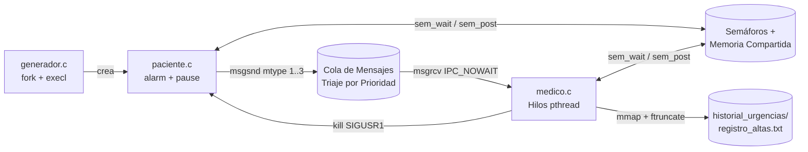

# gestionHospital

**Sistema de Triaje y Quirófanos en Urgencias de un Hospital**

El sistema modela el funcionamiento de un servicio de urgencias hospitalarias donde múltiples pacientes (procesos independientes) llegan con distintos niveles de gravedad y compiten por recursos limitados (boxes de consulta y quirófanos) gestionados por un equipo médico multihilo.

---

## Arquitectura del Sistema



---

## Estructura del Repositorio

* **`comun.h`**: Cabecera compartida por todos los módulos. Define las claves IPC (`ftok`), los nombres de los semáforos, la estructura `EstadoHospital` de memoria compartida y el formato `MensajePaciente` de la cola de triaje.
* **`iniciador.c`**: Programa de arranque que crea e inicializa los semáforos con nombre (`sem_open`), reserva y mapea la memoria compartida (`shmget` / `shmat`) y crea la cola de mensajes (`msgget`).
* **`limpiador.c`**: Programa de limpieza que marca la memoria compartida y la cola de mensajes para borrado (`IPC_RMID`) y desenlaza los semáforos (`sem_unlink`), evitando que queden recursos huérfanos en el kernel entre ejecuciones.
* **`paciente.c`**: Representa a un paciente individual que actualiza la sala de espera en memoria compartida, envía su ficha de triaje a la cola de mensajes y espera atención mediante `pause()`. Si agota su temporizador (`alarm`), recibe `SIGALRM` y abandona el hospital sin ser atendido.
* **`generador.c`**: Proceso lanzador que crea una oleada de $N$ procesos `paciente` en paralelo mediante `fork()` y `execl()` con síntomas y gravedades aleatorias, esperando su finalización con `wait()`.
* **`medico.c`**: Núcleo del hospital. Lanza un equipo de hilos médicos (`pthread_create`) que extraen pacientes por orden estricto de gravedad (`1 = Crítico`, `2 = Urgente`, `3 = Leve`), reservan boxes y quirófanos en exclusión mutua, notifican el alta al paciente con `kill(..., SIGUSR1)`, registran el historial en disco mediante proyección en memoria (`mmap`) y muestran estadísticas de CPU (`times`) al cerrar el turno.
* **`ejecutar.sh`**: Script de automatización en Bash que compila todos los módulos, inicializa los recursos IPC, ejecuta una simulación completa en segundo plano y limpia el sistema al finalizar.

---

## Conceptos de Sistemas Operativos Aplicados

| Mecanismo / Llamada al sistema | Uso en el proyecto |
| :--- | :--- |
| **Shell Scripting (`bash`)** | Orquestación, compilación y control de procesos en *background* (`&`) en `ejecutar.sh`. |
| **Procesos (`fork`, `execl`, `wait`)** | Creación dinámica de pacientes desde `generador.c` y sincronización de cierre. |
| **Señales (`sigaction`, `kill`, `alarm`, `pause`)** | Notificación de alta médica (`SIGUSR1`), timeout de espera (`SIGALRM`) y cierre ordenado (`SIGINT`). |
| **Hilos POSIX (`pthread_create`, `pthread_join`)** | Equipo de médicos concurrentes atendiendo pacientes dentro de `medico.c`. |
| **Semáforos con nombre (`sem_open`, `sem_wait`, `sem_post`)** | Exclusión mutua (`mutex`) y control de capacidad de `boxes` y `quirofanos`. |
| **Memoria Compartida (`shmget`, `shmat`, `shmdt`)** | Panel global `EstadoHospital` compartido entre pacientes y médicos. |
| **Colas de Mensajes (`msgget`, `msgsnd`, `msgrcv`)** | Cola de triaje con extracción prioritaria según `mtype`. |
| **Reloj y Contabilidad (`time`, `localtime`, `times`)** | Sellado horario de altas y medición de tiempo real, de usuario y de sistema. |
| **Directorios y Mapeo (`mkdir`, `ftruncate`, `mmap`, `munmap`)** | Creación de carpeta de historiales y escritura directa en fichero proyectado en memoria. |

---

## Compilación y Ejecución

### Opción A: Ejecución automática (recomendada)
Dar permisos de ejecución al script y lanzar la simulación indicando el número de pacientes (por defecto 8):

```bash
chmod u+x ejecutar.sh
./ejecutar.sh 10
```

### Opción B: Ejecución manual en dos terminales (demostración de prioridades)
Permite observar en tiempo real cómo los pacientes críticos adelantan a los leves en la cola de triaje:

1. **En la Terminal 1** (iniciar recursos y abrir urgencias):
   ```bash
   gcc -Wall iniciador.c -o iniciador -pthread
   gcc -Wall limpiador.c -o limpiador -pthread
   gcc -Wall medico.c    -o medico    -pthread
   gcc -Wall paciente.c  -o paciente  -pthread

   ./iniciador
   ./medico
   ```

2. **En la Terminal 2** (introducir varios pacientes leves y, acto seguido, un crítico):
   ```bash
   ./paciente 3 "Resfriado" &
   ./paciente 3 "Esguince" &
   ./paciente 3 "Mareo" &
   ./paciente 1 "Dolor toracico" &
   ```

3. **Al finalizar** (en la Terminal 1): pulsar `Ctrl + C` (`SIGINT`) para que `medico` cierre el turno, imprima las estadísticas de CPU y ejecute `./limpiador` para liberar los recursos IPC.
